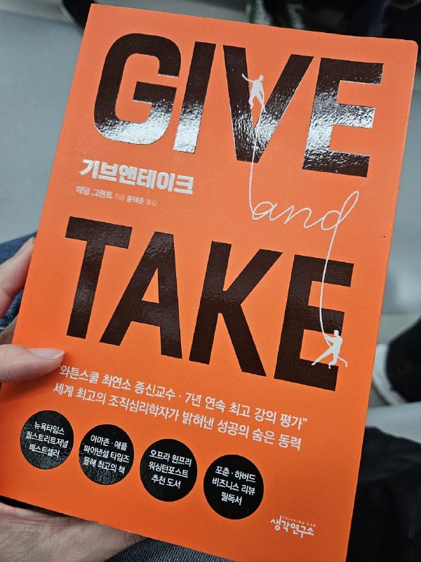

주고 받는 인간 세상에서 주는 사람이 더 잘되더라 라는 훈훈한 이야기를 사회과학적으로 분석하고 인문학적으로 재미있게 풀어냈다. 너무 교훈적이지도 않으면서도 너무 분석적이지 않아서 좋았다.

가장 인상 깊은 것은 내가 이 책을 읽는 것을 본 아내가 오빠는 기버 중에서도 호구되기 쉬운 기버라고 한 것이다. 순간 속으로 '그래서 나랑 결혼한건 아니지...?'

기본적으로 사람의 성향을 기버, 테이커 그리고 매처로 분류해서 분석한 내용을 사례와 함께 풀어낸 책인데, 다른 교훈도 많이 얻을 수 있고, 인간의 근본적인 습성에 대해서도 생각해 볼 수 있는 좋은 책이다.

## 책임편향 Responsibility bias

부부관계에서 각각 40대 60으로 집안일을 한다고해도 실질적으로 본인이 생각하는 기여도를 물어봐서 더하면 100이 훌쩍 넘는다는 것인데, 어찌보면 너무 당연하다는 생각이드는 진리다.

나는 어려서 열역학 법칙을 배울때 비슷한 생각을 했다. 열이 전달될때 반드시 손실이 발생하는데, 인간 사이에도 무언가를 주고받을 때 손실이 발생하는 것이 비슷하다고 생각했다. 그래서 50을 받으면 70이상을 줘야 한다고 생각했다. 나한테 올때 조금 손실되고, 내가 줄때 또 손실되니까...

5만원짜리 선물을 준 친구의 마음에 부합하는 감동을 주려면 최소 7만원은 써야 한다는 논리다.

나는 자연과학으로 접근했는데, 어째든 그게 마음이 편하다.

## 다른 사람의 눈으로 세상을 바라보는 능력

생후 18개월만 지나면 상대방이 좋아하는 것과 싫어하는 것을 구분하고, 상대방이 좋아하는 것을 주려고 한다. 다른 사람의 눈으로 세상을 바라보는 능력은 협업에 있어서 무엇보다 중요한 능력이다.

조직에서 뿐만아니라 세상에서, 성공을 위해서만이 아니라 행복한 삶을 위해서 우리는 다른 사람의 눈으로 세상을 바라보는 능력을 되찾아야한다. 내 생각에 앞에 사례와 같이 그것은 원래 가지고 태어났지만, 퇴보했을 가능성이 크다.

## 자기 충족적 예언

대한민국에서 유명한 짤이 '간절히 원하면 온 우주가 도와준다' 입니다. 박근혜 대통령이 브라질 순방 중 <연금술사>에 나온 말을 인용했다고 하는데, 소설에서는 그것과 반대의 내용이라서 논란이 되었다.

소설에서는 온 우주가 도와주는 일은 없다는 것을 깨닫게 되지만 그 마음이 정신과 의지를 단련시켜서 할 수 있게 된다는 내용이라고 한다. 아직 안봄ㅎ

어째든 자기 충족적 예언은 비슷하게 작동하는데, 결과적으로 상당히 효과가 있다는 것을 사회과학적으로 분석한 내용이 소개된다.

그러니까, 유사 과학이 아니라 사회과학적으로 확인된 결과로, '잘될꺼야\~', '넌 할 수 있어!', '반드시 이뤄낼꺼야' 응원을 여기저기 마구 발사하자! 

## 겸손한 승리

내 좌우명이 '겸손, 성실, 정직' 이다. 이 험난한 세상, 겸손이 진짜 어렵다. 나의 헛점을 보이면 왠지 상대가 그 부분을 공격할것 같기에, 사람들은 치부를 감추고 오히려 강한척을 한다. 하지만 진짜 강한사람은 오히려 자신의 부족함을 드러내도 그것이 약점이 되질 않는다. 제갈공명이 성문을 열고 사마의를 상대한 것이 생각나네.

흔히, 협상에서는 더욱 자신의 부족함을 감추려드는데, 솔직하게 조언을 구하면 오히려 협상이 성사될 확률이 높아진다고 한다. 조언을 구하는 순간 상대방의 협상에 기여하는 모양새가 되기 때문이다.

정말 좋은 포인트인것 같다. 꼭 협상이 아니더라고, 회사에서 업무를 함께할 때, RnR을 나눌때 윈윈할 수 있는 적절한 방법인것 같다. 혼자 성과를 독차지하겠다고 달려들기 보다는 나눠가면서 우군을 확보하고, 또 판을 키울 수 있는 방법으로 사용할 수 있을 것 같다.

## 호구 탈피

책의 결론은 성공하기 위해 위대한 기버가 되라는 것이다. 그러려면 테이커한테 빨리는 호구가 되어선 안되는데, 이때 중요한 마음 가짐은 기버가 나를 위할때는 호구가 될 수 있는데, 문제를 내가 아니라 남 또는 대의를 위한다고 생각하고 테이커처럼 행동하는 것으로 호구를 탈피 할 수 있다는 것이다. 테이커처럼 행동하지만 궁극적으로 기버의 목적을 달성하는 것이다.

인생의 큰 그림에서도 마찮가지다. 단순히 그냥 잘 주는 사람이 아니라 잘 주기위해서 더 성실하고, 정직하게 그리고 겸손하게 행동하기 때문에 결국에 기버가 더 많이 성공한다는 것이다.

많이 공감되고, 많이 생각해보게 되는 좋은 책이다.
