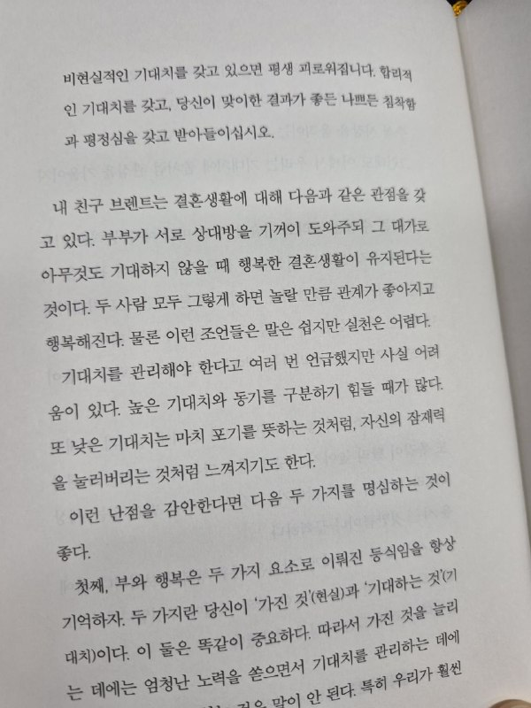

우리는 불확실성을 줄이려고 끊임없이 예측한다. 회사 일도, 개인 프로젝트도 앞으로 어떻게 될지 몇 가지 경우를 그려 보고 나름대로 준비한다. 미래를 대비하려고 하는 일인데, 이러다 보면 아직 일어나지도 않은 일 때문에 먼저 지치기도 한다.

모건 하우절은 미래를 예측하는 대신 역사를 공부하면서 변하지 않는 것들에 집중했고, 그 덕분에 마음이 한결 편해졌다고 한다. 《불변의 법칙》은 그 편안함을 가져다준 이야기들을 묶은 책이다. 쉽고 재미있게 읽었다. 아마 많은 사람이 비슷하게 읽을 것 같다. 경험으로 어느 정도 아는 이야기들이기 때문이다. 너무 당연해서, 그 일이 나한테 또 일어나고 있다는 사실을 자꾸 잊을 뿐이다.

읽는 중에도 회사에서 하던 일이며 개인 프로젝트에서 놓치고 있던 게 하나씩 떠올랐다. 책장에 꽂아 두면 다 읽었다는 사실만 기억할 것 같아서, 책상 위 잘 보이는 곳에 두기로 했다.

## 보이지 않는 것이 리스크다

예상할 수 있는 위험에는 그나마 대비할 수 있다. 서브프라임 사태나 우크라이나 전쟁을 떠올려 보면, 내가 예상하지 못한 일이 벌어졌을 때는 일단 무슨 일이 일어난 건지 파악하는 것부터가 일이었다.

그래서 리스크에 대비하는 데에는 겸손이 필요하다는 생각이 들었다. ‘이 정도면 준비됐지’ 하고 끝내기 전에 놓친 게 없는지 한 번 더 보고, 무슨 일이 생겨도 당장 손쓸 수 있도록 기본기를 다져 두는 것. 그래도 감당할 수 없는 일이 생기면 내 힘으로 어쩔 수 없는 부분은 받아들여야 한다.

늘 타던 지하철도 어느 날 갑자기 멈춘다. 언제 고장 날지 맞힐 수는 없지만, 중요한 약속에 조금 일찍 나서는 건 할 수 있다. 내게 겸손은 그만큼의 시간을 남겨 두는 일이다.

## 기대를 낮추면 행복해질 수 있다

“너무 잘하려고 하지 마. 잘하려고 하니까 힘든 거야.” 오랜만에 만난 고모가 해준 말이 오래 남았다. 회사에서 불안하고 초조하고 떨렸던 순간들을 돌아보면, 그 밑에는 대개 잘하고 싶은 마음이 있었다. 누군가에게 서운하거나 화가 났을 때도 내가 그 사람에게 뭘 기대했는지 생각해 보면 조금 이해가 된다.

대단한 진리도 아닌데 그 순간에는 자꾸 잊는다. 그럴 때 “아이 몰라. 대충 하자. 어떻게든 되겠지” 하고 중얼거리면, 나한테는 효과 빠른 진통제처럼 작동한다. 일이 갑자기 쉬워지는 건 아니지만, 그래도 손을 댈 수는 있게 된다.

진통제로 끼니를 때우면 곤란하겠지만, 매번 미련하게 참을 필요도 없다. 잘하고 싶은 마음을 잠깐 내려놓으면 그 와중에도 웃을 일이 생긴다.

## 뛰어난 스토리가 승리한다

물건이 좋으면 잘 팔릴 거라고, 음식이 맛있으면 손님이 많을 거라고 생각하기 쉽다. 내가 만든 제품을 소개할 때도 기능을 차근차근 설명하면 사람들이 그 가치를 알아줄 거라고 생각했다. 그런데 듣는 사람에게는 기능이 몇 개인지보다 그중 하나가 자기한테 언제 필요한지가 더 궁금할 수 있다.

회사에서도 그렇다. 지시할 때나, 흥정할 때나, 보고할 때나 나는 자꾸 근거부터 늘어놓는다. 속으로는 ‘T끼리는 이 정도면 통하지 않나?’ 싶다가도, 정작 내가 남의 보고를 들을 때는 ‘그래서 지금 무슨 일이 벌어지고 있는데?’부터 알고 싶다. 이렇게 생각해 놓고도 다음번이면 또 설명부터 길어진다. 참 어렵다.

## 측정할 수 없는 힘들이 세상을 움직인다

세상이 통계와 확률대로만 돌아갔다면 돈을 벌거나 사업을 키우는 일도 지금보다는 쉬웠을 것이다. 숫자로 보이는 것만으로도 배울 게 많지만, 숫자에 담기지 않는 사정도 그만큼 많다.

투자나 경영을 공부하는 노력은 존중한다. 블로그로 수익을 내는 법이나 이른바 ‘딸깍 앱 만들기’ 강의에서도 배울 게 있을 것이다. 다만 강의를 다 들었다고 내 블로그에 독자가 생기거나, 내가 만든 앱을 누군가 계속 써 주는 건 아니다. 그 이유는 직접 글을 올리고 앱을 내놓은 뒤에도 한참을 살펴봐야 조금 알 수 있다.

## 마법이 일어나는 순간

책은 대공황이나 전쟁처럼 힘든 시기에 사람들이 놀라운 집중력을 발휘한 이야기를 들려준다. 멀리 갈 것도 없이 파트 일을 할 때도 비슷한 걸 느낀다. 시험이나 과제 마감이 코앞에 닥치면 며칠 전까지 손도 못 대던 일을 갑자기 해내고는 한다.

여기까지는 너무 당연해서 별 감흥이 없었다. 그런데 ‘그럼 적당히 급한 상황을 만들어 보면 되겠네?’까지 생각이 미치니 허구한 날 ‘위기’를 외치던 이건희 회장이 떠올랐다. 개인 프로젝트에 짧은 마감 하나를 정해 두면, 뭘 더 할지 고민하던 시간에 당장 끝낼 것부터 고르게 될지도 모르겠다.

나부터 좀 급박한 상황에 몰아넣고, 와이프랑 아이들도, 그리고 파트원들도… 흠흠. 일단 나부터 해보는 걸로.

## 사소한 것과 거대한 결과

사소한 일이 쌓여 큰 결과를 만든다는 말에 대학생 때쯤 한창 심취했다. 책을 쓰고 싶어서 출근하면 하루에 한 편씩 짧은 에세이를 썼고, 내 회사를 운영해 보고 싶어서 집에 가면 조금씩 코딩을 했다.

문제는 아무도 알아주지 않는 일을 오래 하는 게 정말 힘들다는 것이다. 복리는커녕 이자도 제때 못 받는 기분이다. 나중에 프로그래밍 책을 냈을 때, 그 시절 에세이가 책에 실린 건 아니었다. 그래도 매일 짧은 글 한 편을 끝까지 써 본 경험이 책 한 권을 쓰는 데 녹아들었을 거라고 생각한다.

지금 만드는 프로그램과 블로그, 글과 그림, 흥얼거리며 튕기던 기타가 나중에 어디로 이어질지는 모르겠다. 뭐가 됐든 언젠가 나를 웃게 해주겠지. ㅋ

나는 잘하는 것보다 못하는 게 많지만, 못하는 것도 그냥 해보는 게 장점이다. 6km를 1km당 5분 40초 페이스로 간신히 뛰면서 “저도 러닝해요” 하고, 맨날 에어볼을 던지면서도 농구 모임에 나간다. 노래도 잘 못하면서 피아노에 기타까지 어설프게 연습한다. 그런 나를 귀엽게 봐주고 응원해 주는 가족과 친구들이 참 고맙다. 나도 누군가 어설프게 시작할 때 옆에서 그렇게 응원해 주고 싶다.

## 희망 그리고 절망

비관론자처럼 저축하고 낙관론자처럼 투자하라는 말이 기억에 남았다. 낙관과 비관 중 어느 쪽이 맞느냐보다, 언제 어느 쪽이 필요한지를 생각하게 하는 말이었다.

전쟁 포로가 ‘다음 주면 전쟁이 끝날 거야’라는 기대만 품고 있으면, 다음 주가 와도 달라진 게 없을 때 또 한 번 무너진다. 그렇다고 살아서 가족에게 돌아갈 수 있으리라는 믿음까지 놓으면 오늘 하루를 버틸 이유를 찾기 어렵다. 오늘 견뎌야 하는 현실을 보면서도, 언젠가는 이 전쟁이 끝난다고 믿는 것. 두 마음이 한 사람 안에 같이 있어야 한다.

내 일에도 두 마음이 다 있다. 이렇게 해서 대박은커녕 쓰는 사람이 한 명이라도 늘까 싶어 현타가 오는 날이 많다. 그러다가도 잠들기 전이면 어김없이 크게 성공하는 상상을 한다. ㅋ

## 인센티브

책에서는 인센티브가 사람을 미치게 만들 만큼 강력하다고 한다. 나는 내가 그런 데 별로 민감하지 않다고 생각해 왔다. 이건희 회장이 인센티브를 강조해 회사 임금 체계를 손봤다는 이야기를 들었을 때도, 정작 반기나 연간 성과급이 내 일하는 방식을 크게 바꾼다는 느낌은 없었다.

부서 운영을 해보거나 아이들에게 칭찬 스티커를 줘 봐도, 스스로 하고 싶어서 할 때의 힘이 더 크게 느껴졌다. 그렇다고 내가 인센티브에 무심하다고 단정할 수 있을까. 내가 보너스나 스티커만 떠올려서 그런지도 모르겠다. 회사에서 내가 자꾸 신경 쓰는 건 뭔지, 아이들이 스티커를 다 모은 뒤에도 계속하고 싶어 하는 건 뭔지, 한 번 더 살펴봐야겠다.

## 복잡함과 단순함

책을 읽다가 무릎을 탁 친 대목이다. 우리는 단순한 방법이 통한다는 걸 알면서도 복잡한 쪽에 더 공을 들인다. 나는 제품을 만들면서 같은 걸 여러 번 느꼈다. 이것저것 할 수 있는 제품보다, 사람들이 써 보자마자 ‘아, 이거 편하네’ 하는 기능 하나가 더 강할 때가 있었다.

스포츠든 음악이든 공학이든 처음에는 핵심 몇 가지를 익히는 것만으로도 꽤 멀리 갈 수 있다. 솔직히 나는 많은 경우 거기까지만 간다. 가끔은 내가 좀 약았나, 진득하게 배우는 맛을 모르나 싶었는데, 책을 읽고 나니 그 버릇에 붙일 만한 핑계가 하나 생겨서 좋다.

담배를 피운다면 끊는 것, 잠을 충분히 자고 몸을 움직이는 것, 돈을 모으고 싶으면 오늘 새는 작은 돈부터 돌아보는 것. 다 아는 일인데 안 하는 것도 많다. 나는 그 당연한 걸 꾸준히 해서 차별화하고 돈을 벌어야겠다! 내일 또 잊어버릴 수 있으니, 책은 일단 책상 위에 두고.
